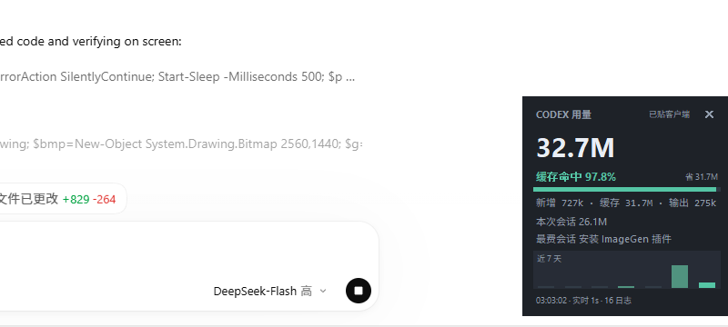
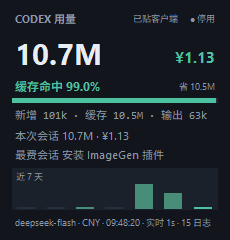

# Codex 用量挂件 · codex-usage-stats

一个 Codex 插件：从本机 rollout 日志读 token 用量，给出命令行报告，并在 Codex 客户端右下角贴一个**人民币计价的实时挂件**——今天用了多少 token、花了多少钱、缓存命中率多少。

只读本机日志，不联网、不上传、不改客户端。



[English](#english)

## 它能做什么

- **今日读数**：token 总量、费用（¥）、缓存命中率与进度条，新输入 / 缓存读 / 输出三段拆分。
- **本次会话**：当前对话的 token 与费用；底部还有当日最重的会话。
- **近 7 天柱状图**，双击挂件立即重算。
- **实时刷新**：增量 tail 每秒读一次正在增长的日志，每 60 秒全量重算兜底。
- **贴在客户端里**：挂件是客户端窗口的 owned window，随客户端置顶、最小化隐藏，位置始终被夹在客户端内容区，拖不出应用窗口。
- **内部启停按钮**：标题栏的 `● 停用` 一键收起成小条，再点小条展开；右键菜单里同样有停用 / 启用 / 退出，停用状态不写盘，**每次打开客户端都会自动重新贴回**。防误关照旧：没有 ✕，Alt+F4 也会被忽略。
- **命令行报告**：按天 / 线程 / 模型 / 文件 / 单次来回汇总，可出 JSON，可带或不带费用。

## 环境要求

- **Windows 10 / 11**。挂件依赖 Win32 的窗口归属与置顶接口，其他平台不适用。
- **Python 3.10+**，只要标准库（`tkinter`、`ctypes`、`json`）。本仓库在 Python 3.12 上验证。
- Codex 客户端或 CLI（日志目录 `%USERPROFILE%\.codex`，可用 `CODEX_HOME` 覆盖）。

## 安装

### 方式一：当插件市场装（推荐）

```bash
codex plugin marketplace add nixuejun888/codex-usage-stats
codex plugin add codex-usage-stats@codex-usage-stats
```

然后开一个新会话：`SessionStart` 钩子会把挂件贴到客户端右下角（首次会要求信任该钩子）。钩子没生效时，挂件也能手动拉起，见下一节。

### 方式二：克隆后作为本地插件市场

```powershell
git clone https://github.com/nixuejun888/codex-usage-stats.git
codex plugin marketplace add .\codex-usage-stats
codex plugin add codex-usage-stats@codex-usage-stats
```

### 方式三：只要命令行报告

`scripts/codex_usage.py` 是自包含的，把 `scripts/` 三个 `.py` 拷到任意目录即可运行，无需安装插件。

## 挂件怎么开、怎么关

挂件内部就有启停开关：标题栏右侧的 `● 停用`。点一下，整个挂件收成一行 `○ 已停用 · 单击启用` 的小条，位置仍在同一个角；点小条就展开回来。右键菜单里有同一对开关（`停用挂件（收成小条）` / `启用挂件`），再加一条 `退出挂件（下次开客户端自动回来）`。



停用后整个挂件收成一行小条，位置不变，点它即恢复：


```powershell
pythonw hooks\ensure_widget.py          # 拉起挂件（幂等，不会叠出第二个）
pythonw hooks\ensure_widget.py --status # running / idle
pythonw hooks\ensure_widget.py --stop   # 与菜单里的「退出挂件」等效
```

双击插件根目录的 `start-widget.cmd` 与第一条等价。

**每次打开客户端都会自动贴回来**：插件的 SessionStart 钩子在每次会话开始（含恢复会话）时拉起挂件，而「停用 / 退出」都不写盘，所以上次怎么关都不影响下一次启动。想让它在 Windows 登录时就起来（而不是等客户端启动），把 `start-widget.cmd` 的快捷方式丢进 `shell:startup`。

防误关仍然在：没有 ✕，`WM_DELETE_WINDOW`（含 Alt+F4）被拒绝，并会在脚注闪一行 `已锁定：✕ 无效，请用「停用」或右键菜单退出`。调试挂件本身时可以用 `--allow-close` 恢复可关闭行为。

挂件支持的开关：`--client-exe`（贴住哪个进程，默认 `ChatGPT.exe`，其次 `Codex.exe`）、`--margin`（贴角留白，默认 14px）、`--opacity`、`--follow-ms`、`--no-topmost`、`--live`、`--rescan`、`--stay-visible`、`--codex-home`、`--no-price`、`--usd`（改按美元价目）、`--selftest`（打印几何并做越界拖动自检）、`--watch N`（无界面跑 N 秒并打印读数）。

## 命令行报告

```bash
python scripts/codex_usage.py                        # 按本地日期
python scripts/codex_usage.py --by thread --top 10   # 最费 token 的线程
python scripts/codex_usage.py --by model --since 2026-10-01
python scripts/codex_usage.py --by turn --since 2026-10-11   # 每次来回花了多少
python scripts/codex_usage.py --json                 # 机器可读
python scripts/codex_usage.py --no-price             # 只看 token，不要费用列
```

| 参数 | 说明 |
|------|------|
| `--by {day,thread,model,file,turn}` | 汇总维度，默认 `day` |
| `--since` / `--until` | 起止日期，`YYYY-MM-DD`（**本地时区**） |
| `--top N` | 只留最大的 N 行，`0` 为全部 |
| `--no-archived` | 忽略 `archived_sessions/`（默认包含） |
| `--json` | JSON 输出，含价目与货币字段 |
| `--no-price` | 不套内置价目，只统计 token |
| `--price-in` / `--price-cache` / `--price-out` | 换成你自己的单价（元 / 每 1M token），覆盖内置表 |
| `--usd` | 改用 DeepSeek 的美元价目 |
| `--codex-home` | 指定 Codex 数据目录 |

`--by turn` 的一行 = 一条用户消息加上模型为它做的全部工作，标签是本地时间和线程，用来回答「这一次来回花了多少」。

## 费用：人民币口径

价目表在 [`scripts/deepseek_pricing.py`](scripts/deepseek_pricing.py)，**默认单位是人民币**，取自 DeepSeek 官方中文定价页，是官方的元价，不是拿美元价乘一个自己编的汇率得出的：

| 模型 | 缓存命中 | 缓存未命中 | 输出 |
|------|---------|-----------|------|
| `deepseek-flash` | ¥0.04 | ¥2 | ¥8 |
| `deepseek-v4-pro` | ¥0.30 | ¥9 | ¥27 |

单位：元 / 每 1M token，**高峰价**。两条规则决定了这个数准不准：

- **每条 response 按自己的时间戳定价。** 空闲价正好是高峰的一半；高峰为北京时间周一至周五 09:00–12:00 与 14:00–18:00（UTC 01:00–04:00、06:00–10:00），周末与法定节假日全天空闲。所以一整天的账不能乘单个系数——周六全天空闲，工作日早高峰不是。
- **输入要拆缓存命中与未命中。** 日志里的 `input_tokens` 已经含缓存部分，`cached_input_tokens` 按命中价、其余按未命中价；`cache_write_input_tokens` 不收费；`reasoning_output_tokens` 已包含在 `output_tokens` 里，不重复计。

`--usd` 切到英文页的美元价目（0.006 / 0.30 / 1.20 与 0.044 / 1.32 / 3.96），两表比值恒为 6.6667，可用来交叉验证抄录正确。

法定节假日不预置日期（每年都在变，写死的表会算错价）：把 `CODEX_USAGE_HOLIDAYS` 设成 `YYYY-MM-DD` 逗号分隔的列表即可按空闲计价，不设则那些天按高峰算。

## 目录结构

```
.codex-plugin/plugin.json          插件清单（版本、界面文案、图标）
.agents/plugins/marketplace.json   让本仓库同时可作插件市场被 codex plugin marketplace add
skills/codex-usage-stats/SKILL.md  技能说明：让模型知道何时读日志、如何报数
hooks/hooks.json                   SessionStart 钩子定义
hooks/ensure_widget.py             幂等拉起 / 查状态 / --stop
scripts/codex_usage.py             命令行报告（自包含，可单独拷走）
scripts/deepseek_pricing.py        价目表与高峰 / 空闲、货币换算
scripts/usage_widget.py            挂件本体（tkinter + Win32 窗口归属）
start-widget.cmd                   双击启动
```

## 数字为什么可信

- 日志在 `<codex-home>/sessions/YYYY/MM/DD/rollout-*.jsonl` **和** `<codex-home>/archived_sessions/`；归档是移动而非删除，只扫 `sessions/` 会漏——本机实测一天漏掉 87M token（29.3M vs 116.5M）。默认两边都扫。
- 用量取自 `token_usage_record` 事件（每个模型 response 一条），`turn_context` 提供每轮的模型，`session_meta` 标记子代理。`token_count` 是线程累计值，适合抽查、不适合求和。
- 日志时间戳是 UTC，`turn_context.timezone` 才是用户时区；按本地时区分桶，否则晚间会话会落到错误的日期。
- `input_tokens` **包含** `cached_input_tokens`，`reasoning_output_tokens` 是 `output_tokens` 的**子集**，`total_tokens = input + output`，三列不能相加。
- 按 `response_id` 去重：恢复的线程和归档副本会重复记录。
- 子代理（`session_meta.source.subagent`）花的是真 token，计入总量。
- 实时数字建立在两个会打败直觉的 Windows 行为上：进程持有日志时，目录枚举给出的 size 与 mtime 都是陈旧的（正在写的日志可能看起来几小时没动），针对单个文件的 `stat()` 能刷新 size 却刷不了 mtime。所以挂件按**最后一条记录**的时间戳挑活跃日志，靠两次轮询之间的**文件大小**判断增长，从不看 mtime。

## 局限

- 是**按官方列表价估算的人民币**，不是账单。余额、赠送额度、账号级折扣在日志里看不到。
- 未在价目表里的模型会计为 0：CLI 会点名未知模型，挂件会在脚注标出模型名或直接写 `价目未知`。
- 今天的总量会变——正在写入的日志每秒钟都在长。
- 只统计这台机器、这个 Codex 数据目录。对同一份日志，`npx -y ccusage@latest codex daily` 在每一个已结束的日期上都与本脚本完全一致（注意它的美元列用的是 OpenAI 价目，不能当作本机成本）。

## 许可

[MIT](LICENSE)。非 OpenAI / DeepSeek 官方项目，与二者无从属关系；「Codex」「DeepSeek」仅用于说明兼容与计价口径。

## English

A Codex plugin that reads this machine's rollout logs (read-only, offline) and
prints token-usage reports, plus a **yuan-priced live panel** with an in-panel
on/off switch, docked into the bottom-right corner of the Codex client
window. The panel is re-docked automatically on every client launch, while still
refusing accidental closes (no ✕, Alt+F4 ignored). Cost is estimated from
DeepSeek's official CNY list prices (¥/1M tokens: cache hit / miss / output),
priced per response at peak or off-peak (off-peak is exactly half, peak is
09:00–12:00 and 14:00–18:00 Beijing time on weekdays). `--usd` switches to the
dollar table. Windows 10/11, Python 3.10+, standard library only.

```bash
codex plugin marketplace add nixuejun888/codex-usage-stats
codex plugin add codex-usage-stats@codex-usage-stats
```

Licensed under MIT.
